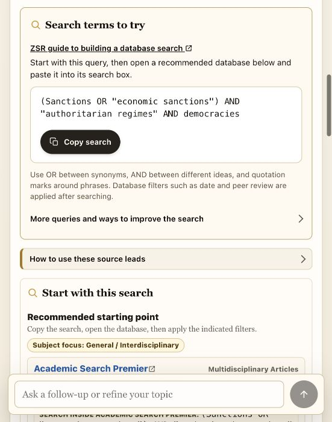
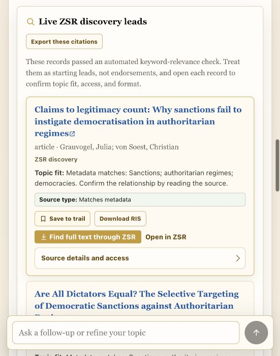
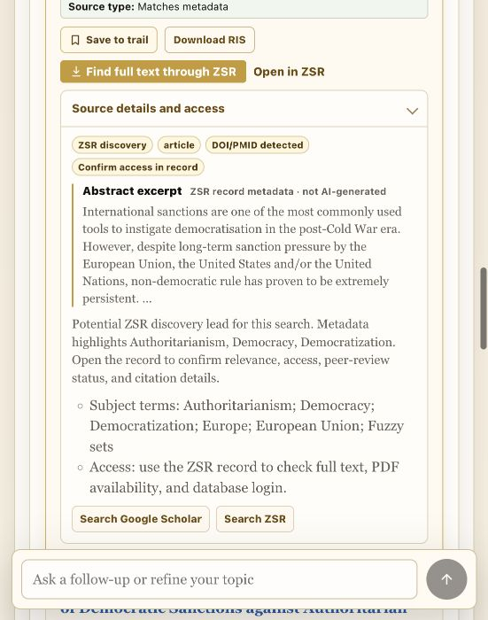

# Search and design review — 28 September 2026

The next release should improve which five sources rise to the top and how quickly a student can judge them. The current interface has clearer spacing and useful source provenance, but query planning, comparison handling, and result density still limit the experience.

## Scope and evidence

Reviewed the existing sanctions search in the running local preview at its current 551-pixel viewport, inspected its first source's provider abstract, and read the query compilation, filtering, ranking, metadata, and presentation code. Reproduced the search plan with the current local planner. This was not a new live search across providers, a full-text assessment, a usability study, or a full accessibility audit. No application code was changed during this review.

## Captured flow

### 1. Search strategy — usable, but query quality needs work

The query and copy control are readable. The guide is accessible, and search terms appear before database links as requested by faculty. However, the displayed query requires sanctions, authoritarian regimes, and democracies together. The plan classifies the topic as General / Interdisciplinary and recommends Academic Search Premier first.

The current planner reproduced these live-search candidates:

1. `Sanctions AND "authoritarian regimes" AND democracies`
2. The same concepts plus `"longitudinal study"`
3. The same concepts plus `"qualitative study"`
4. The same concepts plus `"case study"`
5. The same concepts plus `"systematic review"`

The user did not request these methods. These fallbacks narrow the query and can displace useful synonym variants. Give comparison intent and subject routing explicit treatment. Keep the query-first database workflow in a Search strategy view.

### 2. Source results — readable, too tall to scan

Five initial records and the additional-results disclosure now work. Each record has a real provider link, save action, and citation export. At this width, however, the first card consumes roughly half the viewport, with repeated metadata explanations, several actions, and nested borders. The section introduction plus one card nearly fills the visible reading area. Publication year and journal are not visible on this result.

Show title, authors, year, journal, one useful abstract excerpt or evidence-based fit note, and compact actions. Move detailed requirement checks and export formats into Details and Cite. Keep uncertainties visible when they affect selection. Use consistent wording such as Save, Open source, and Cite instead of mixing My sources, trail, lead, record, and RIS.

Accessibility risks to test: compact text and small action targets at narrow widths, wrapping of long titles and metadata, keyboard operation of details and filters, zoom reflow, and focus around the fixed composer. Screenshots cannot establish full compliance.

### 3. Source details — useful evidence is buried

The first record provides an explicitly labeled, non-AI abstract excerpt. That is stronger evidence for judging relevance than the repeated list of matched keywords. The excerpt discusses democratization under sanctions in non-democratic regimes; it does not, in this excerpt, establish a direct comparison with democratic target regimes. This is not a judgment that the full article is irrelevant.

Promote a short provider excerpt to the card. Keep full metadata, access routes, and longer excerpts in an accessible details panel. Collapse repeated provider/type/identifier badges. Preserve the distinction between discovery, full-text access, peer-review metadata, and verified claims.

## Recommended implementation order

1. **Fix query planning and subject routing.** Add explicit comparison intent to the research specification. Retrieve direct comparative work, then separately labeled work on each side when useful. Expand sanctions/autocracy/democracy terminology and include regime-type language; avoid treating a comparison as three mandatory literal phrases. Remove unrequested method constraints from automatic fallbacks. Route sanctions and regime-type questions to political science/international relations using configured library resources. Keep explicit assignment constraints intact and disclose any proposed relaxation.

2. **Rank a candidate pool against the full question.** The public discovery path stops trying alternate queries after five qualifying results. Its scoring emphasizes word overlap, and fallback groups are concatenated rather than ranked together. Retrieve a bounded pool under a time budget, deduplicate it, and apply one final ranking across queries. Evaluate a title-and-abstract reranker against the existing ranker; keep a deterministic fallback. Separate direct comparison candidates from narrower supporting literature and background. A reranker is a relevance estimate, not factual validation. This follows the general retrieve-then-rerank pattern in the [Sentence Transformers documentation](https://www.sbert.net/examples/sentence_transformer/applications/retrieve_rerank/README.html); improvement for ZSR must be measured locally.

3. **Complete and consolidate source metadata.** Prefer DOI identity and merge complementary metadata from duplicate records instead of merely retaining the first. Recover dates and journal names from provider fields where available. The current Primo normalizer reads the display creation date or top-level date, and the card metadata line omits the journal. Preserve access paths when a work appears in library and open-access results. Mark missing data as unknown; never generate a missing author, date, DOI, abstract, or publication status.

4. **Make sources the main results view.** For source-finding requests, show an editable topic and active filters above Results, with Search strategy and Saved sources one click away. Put query tools before database links within Search strategy, preserving the faculty workflow. Offer relevance/date sorting and understandable source-type/date/access filters. Make follow-up help optional so the fixed chat composer consumes less space. Use compact source rows, five initially, with the remainder in Show more.

5. **Improve empty-result recovery.** Preserve provider failures separately from genuine zero matches. Explain the constraint that appears limiting, show exactly what a broader search would change, and let the user run it. Never silently remove required dates, peer review, or source types. Label partial matches clearly rather than presenting them as meeting the entire request.

6. **Measure relevance and usability with people.** Current automated evaluation: 56/56 cases and 1,232/1,232 checks pass; 56 cases await human review, with zero completed reviews. Create a librarian-rated set of actual retrieved records covering comparison questions, ambiguous topics, exact-title lookups, date requirements, and sparse topics. Track useful results among the first five, duplicate rate, metadata completeness, known-topic empty results, and response time. Observe students finding and saving their first useful source. Compare candidate rankings before adopting a more complex model.

## Hallucination boundaries

Real source records do not prove an AI interpretation of those records is correct. Keyword overlap does not prove comparative relevance. A DOI does not prove peer review or Wake Forest access. Keep bibliographic facts provider-backed. If AI generates a relevance explanation, ground it in the displayed abstract and label it as an interpretation. Do not display invented confidence percentages. Claims about study findings require supporting source text; metadata alone is insufficient.

## Code inspected

- `config/researchSpec.js`, `config/subjectFocus.js`, `config/researchAgent.js`: concepts, subject routing, generated plans.
- `server/liveSearchQueries.js`: candidate query selection and five-query cap.
- `server/primo.js`, `server/primoApi.js`: retrieval, scoring, filtering, early stopping, result merging, metadata normalization.
- `server/sourceRelevance.js`: required concept matching from metadata.
- `server/sourceDiscovery.js`: provider outcomes and independent library/open-access retrieval.
- `src/sourceDedup.js`: DOI/title/author normalization and first-record retention.
- `src/AssistantMessage.jsx`: source-card content, actions, excerpts, and five-result display.
- `lib/pilotEvaluation.js` and current evaluation datasets: automated and human-review status.

The official [Primo Search API reference](https://developers.exlibrisgroup.com/primo/apis/docs/primoSearch/R0VUIC9wcmltby92MS9zZWFyY2g%3D/) documents Boolean queries and relevance/date sorting. Institutional configuration and result metadata still need validation in the actual deployment; the existence of an API feature is not evidence that it is enabled here.
